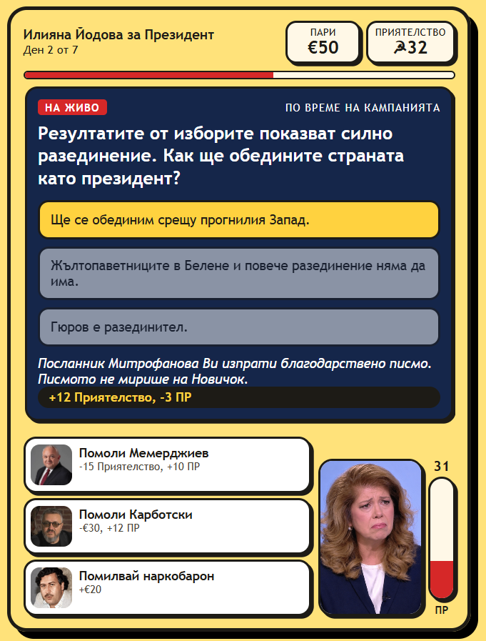

# Помилвай ме / 40 години назад

### Отказ от отговорност
Всички персонажи и събития в тази игра - дори тези, основани на реални хора - са изцяло измислени.

## За играта
Проект, който има за цел да осмее един конкретен политик, който много обича Русия и наркобароните.

Поемете контрол над госпожа Йодова в битката ѝ за президентския пост.

- **Помилвайте наркобарони** - помилвайте наркобосове, които Ви се отблагодаряват с капитал, но внимавайте - всяко помилване увеличава риска от скандал, който може да срине рейтинга Ви.
- **Купете армия от тролове** - насочвайте общественото мнение с помощта на приятели от изтока.
- **Заглушавайте критиците** - използвайте властта си, за да сваляте неудобни сатирични страници.
- **Отговаряйте на въпроси от журналисти** - всеки отговор в полза на Русия Ви носи точки приятелство, но сваля рейтинга ви.

Целта е проста: да оцелеете до края на седмицата с достатъчно висок рейтинг, за да спечелите изборите.

Ще се дадете ли на атаките на сатиричните страници или ще успеете да върнете България 40 години назад?

